<!-- 霓虹故障风头图 -->

<!-- 会动的终端 -->

<!-- 徽章墙 -->

---

### ⚡ 武 器 库

---

### 🚀 代 表 作

---

### 📊 战 绩

---

### 📈 活 跃 曲 线

---

### 🏆 成 就 墙

---

### 🐍 贡 献 贪 吃 蛇

<picture>
  <source media="(prefers-color-scheme: dark)" srcset="https://raw.githubusercontent.com/ychech/ychech/output/github-snake-dark.svg" />
  <source media="(prefers-color-scheme: light)" srcset="https://raw.githubusercontent.com/ychech/ychech/output/github-snake.svg" />
  
</picture>

---

### 🎲 随 机 箴 言

---

